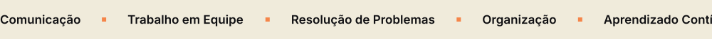

  

  

  
  

  

- **Desenvolvedor Júnior** apaixonado por tecnologia e desenvolvimento web
- Trabalho com **Java e Spring Boot** no back-end
- Uso **Inteligência Artificial** para construir soluções mais inteligentes e produtivas
- Transformo dados em insights com **Análise de Dados**
- Modelagem e consultas em **Bancos de Dados (SQL e NoSQL)**
- Integrações corporativas com **SAP, TOTVS e Web Services (SOAP)**
- Automação de processos com **n8n** e containers com **Docker**
- Fluxo de trabalho organizado com **Kanban** e práticas ágeis

  

  

  

  
  

  

  

  

  <!-- Substitua o "#" pelos seus links reais e o e-mail abaixo pelo seu -->
  
  
  
  
  

  

