  

  

  
  

## 🚀 Sobre mim

  

- 💻 **Desenvolvedor Júnior** apaixonado por tecnologia e desenvolvimento web
- ☕ Trabalho com **Java e Spring Boot** no back-end
- 🧠 Uso **Inteligência Artificial** para construir soluções mais inteligentes e produtivas
- 📊 Transformo dados em insights com **Análise de Dados**
- 🗄️ Modelagem e consultas em **Bancos de Dados (SQL e NoSQL)**
- 🔗 Integrações corporativas com **SAP, TOTVS e Web Services (SOAP)**
- ⚙️ Automação de processos com **n8n** e containers com **Docker**
- 📋 Fluxo de trabalho organizado com **Kanban** e práticas ágeis

## ⭐ Meus diferenciais

  

## 🛠️ Tecnologias

**Principais**

  

**Também trabalho com**

  

**Ferramentas e integrações corporativas**

## 🤝 Habilidades interpessoais

## 📊 Estatísticas no GitHub

  
  

  

  

## 🐍 A cobrinha das contribuições

  <picture>
    <source media="(prefers-color-scheme: dark)" srcset="https://raw.githubusercontent.com/llypeDev/llypeDev/output/snake-dark.svg" />
    <source media="(prefers-color-scheme: light)" srcset="https://raw.githubusercontent.com/llypeDev/llypeDev/output/snake.svg" />
    
  </picture>

## 📫 Vamos nos conectar

  <!-- Substitua o "#" pelos seus links reais e o e-mail abaixo pelo seu -->
  
  
  
  

  

